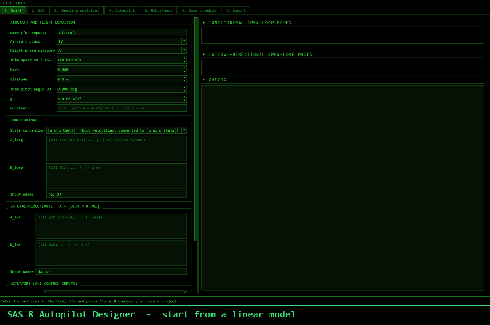
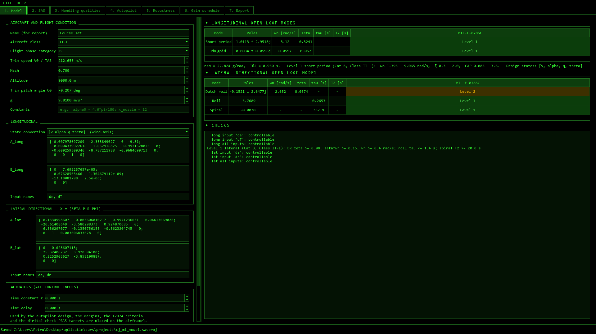
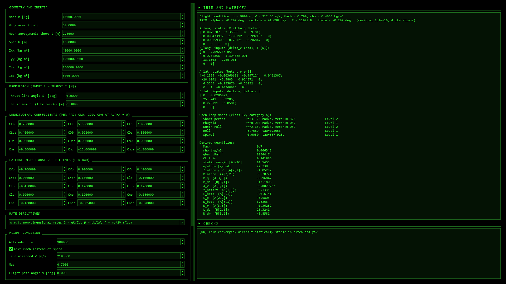
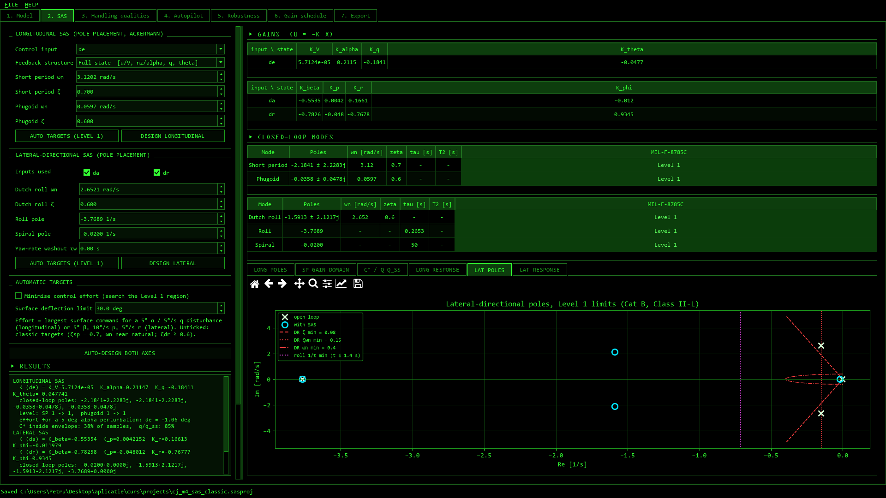
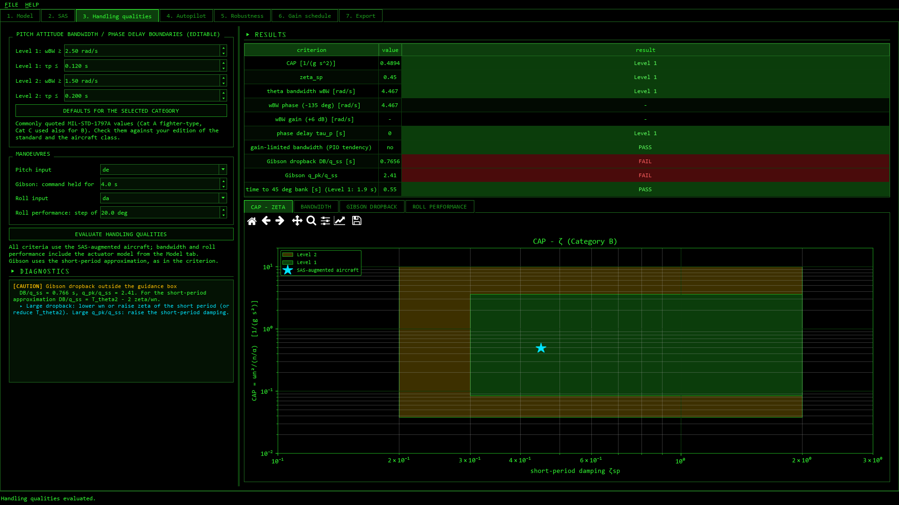
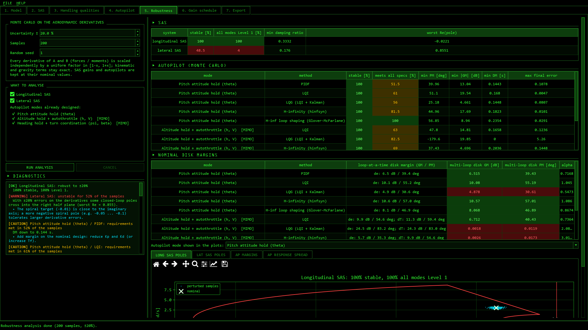
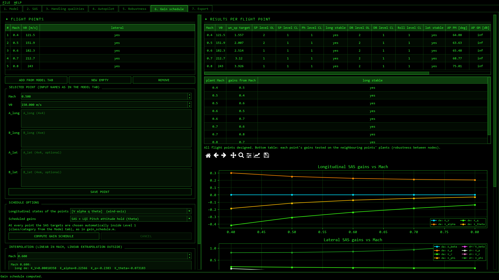
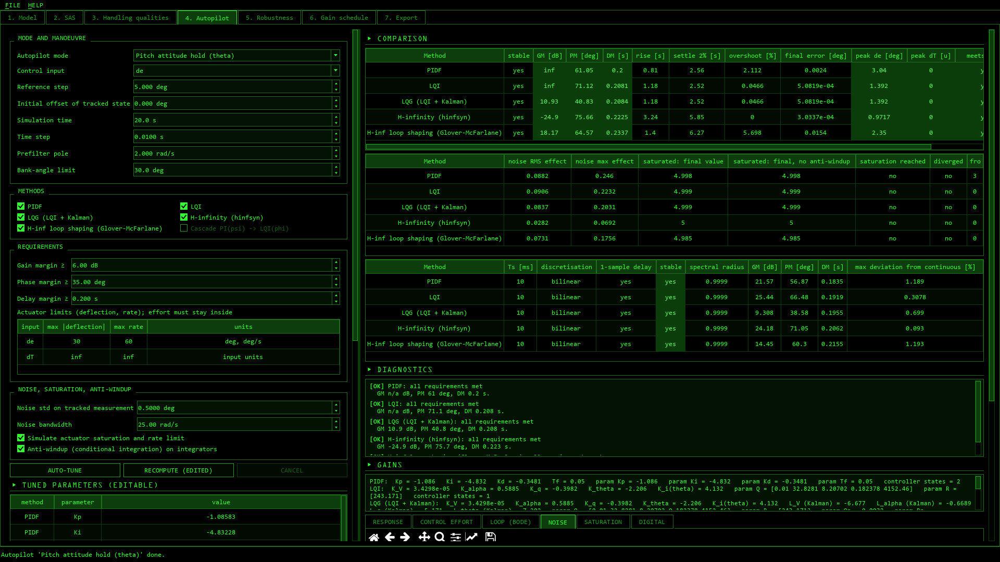
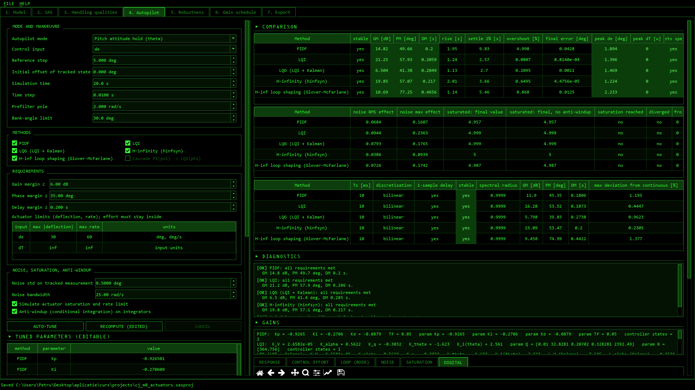
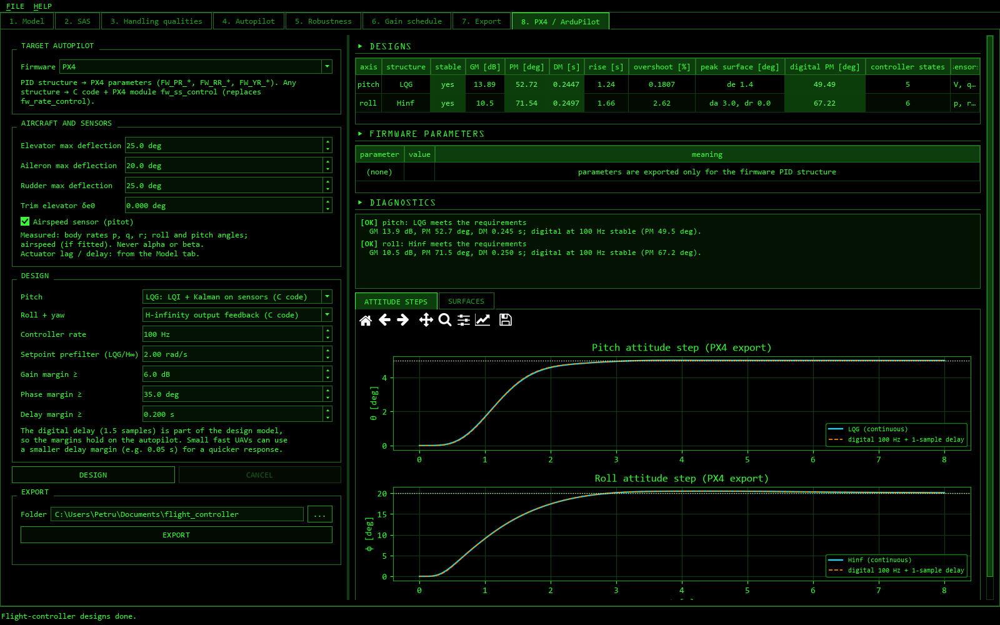

<div align="center">

# SAS & Autopilot Designer

**From aerodynamic coefficients to a verified flight control system — in one desktop app.**

Design stability augmentation systems and autopilots for fixed-wing aircraft, check them against
MIL-F-8785C / MIL-STD-1797A, stress-test them for robustness and digital implementation,
and export everything to MATLAB & Simulink — or straight to **PX4 and ArduPilot** autopilots.


[](LICENSE)



</div>

---

## Why

Designing a flight control system usually means a pile of scripts: one for trimming, one for the SAS, one
per autopilot method, more for handling qualities, noise, saturation, sampling and gain scheduling — each with
its own conventions. **SAS & Autopilot Designer** puts the whole chain behind one interface, tunes every
controller automatically against the same requirements, and tells you in plain words what is wrong and what
to change when a requirement fails.

## Features

| | |
|---|---|
| **Aircraft model** | Paste A/B matrices in MATLAB syntax, import a `.mat`, or **build them from aerodynamic coefficients** (ISA atmosphere → Newton trim → numerical linearisation). Longitudinal `[u w q θ]` or `[V α q θ]`, lateral `[β p r φ]`. Actuator lag + delay. |
| **Open-loop analysis** | Short period, phugoid, dutch roll, roll, spiral — each rated Level 1/2/3 per MIL-F-8785C for the chosen class and flight-phase category; controllability checks. |
| **SAS** | Pole placement with automatic Level-1 targets (classic or **minimum control effort**), yaw damper with washout. |
| **Handling qualities** | MIL-STD-1797A: CAP, bandwidth / phase delay, Gibson dropback, roll performance; C* and q/q_ss envelopes. |
| **Autopilots** | Pitch, altitude, speed, bank, heading, β = 0, plus MIMO altitude + autothrottle and heading + coordination. |
| **Design methods** | PIDF · LQI · LQG (with loop-transfer-recovery selection) · H∞ (`hinfsyn`) · H∞ loop shaping (Glover–McFarlane) · cascade PI(ψ) → LQI(φ). All auto-tuned for gain, phase and delay margin and actuator limits, then editable. |
| **Real-world effects** | Sensor noise, actuator saturation and rate limits, anti-windup, **digital implementation** (Tustin / ZOH / Euler, one-sample delay, suggested sample rate). |
| **Robustness** | Monte Carlo on the aerodynamic derivatives and disk margins (loop-at-a-time and multi-loop, μ upper bound). |
| **Gain scheduling** | Designs at several Mach numbers and interpolates the gains across the envelope. |
| **Export** | PDF report, PNG figures, Excel / CSV, and a **MATLAB package** that rebuilds the closed loop and generates a ready-to-run **Simulink model**. |
| **PX4 / ArduPilot** | Attitude controllers for fixed-wing drones that use only the autopilot's sensors (rates, attitude, airspeed — no α/β): the firmware's own PID structure auto-tuned and exported as **PX4 `.params` / ArduPilot `.param`**, or **LQG / H∞ output feedback exported as C code + a PX4 module** (`fw_ss_control`) that replaces the rate controller. Digital delay included in the design. |
| **Workflow** | `.sasproj` projects (results recomputed on open), cancellable long tunings, F1 user guide, *Diagnostics* panel on every design tab, cockpit-style dark UI. |

## Screenshots

| Model and open-loop modes | Matrices from aerodynamic coefficients |
|---|---|
|  |  |
| **SAS design** | **Handling qualities (MIL-STD-1797A)** |
|  |  |
| **Robustness: Monte Carlo + disk margins** | **Gain schedule across Mach** |
|  |  |
| **Autopilot: five methods compared** | **Digital implementation check** |
|  |  |
| **PX4 / ArduPilot export** | |
|  | |

## Quick start

### Windows installer (recommended)

1. Download `flight-control-designer.exe` (the installer) from the
   [latest release](https://github.com/Petru1803/flight-control-designer/releases/latest).
2. Run it — it installs for your user only, no administrator rights needed. If SmartScreen appears, choose
   *More info → Run anyway*.
3. Start **SAS & Autopilot Designer** from the Start menu. Double-clicking a `.sasproj` file opens it directly.

**If you do not want to download an .exe file, you can download the entire project and run main.py after you install requirements.txt.**

### From source

```bash
git clone https://github.com/Petru1803/flight-control-designer.git
cd flight-control-designer
python -m venv .venv
.venv\Scripts\activate
pip install -r requirements.txt
python main.py
```

Requires Python 3.14 (3.11+ should work). `slycot` provides the SLICOT routines used for H∞ synthesis.

## How it works — the 7 tabs

```
1 Model ─► 2 SAS ─► 3 Handling qualities ─► 4 Autopilot ─► 5 Robustness ─► 6 Gain schedule ─► 7 Export
                                                                                     └─► 8 PX4 / ArduPilot
```

1. **Model** — set the aircraft class (I, II-L, II-C, III, IV) and flight-phase category (A/B/C), the flight
   condition, and the matrices (typed, imported or computed from coefficients).
2. **SAS** — accept the automatic Level-1 targets or edit them; gains by pole placement.
3. **Handling qualities** — judge the augmented aircraft against MIL-STD-1797A.
4. **Autopilot** — pick a mode, tick one or more methods, press **Auto-tune**. Compare step response,
   effort, margins, noise, saturation and the digital implementation side by side.
5. **Robustness** — perturb the derivatives (±x %) and see the share of stable / Level 1 / compliant cases.
6. **Gain schedule** — repeat the design over a Mach range and interpolate.
7. **Export** — report, figures, spreadsheets, or a MATLAB/Simulink package:

```matlab
S = mydesign_load();                              % models, gains, controllers (continuous + discrete)
mydesign_load('closedloop', S, 'theta', 'LQI');   % rebuild the closed loop and its step response
mydesign_load('simulink',   S, 'theta', 'LQI');   % generate a Simulink model
```

8. **PX4 / ArduPilot** — choose the firmware, the surface deflections and a structure per axis, press
   **Design**, then **Export**:
   - PX4: `<name>_px4.params` (firmware PID structure, load in QGroundControl) and/or the module
     `fw_ss_control/` (C code + C++ module + install script); in the PX4 shell: `fw_rate_control stop`,
     `fw_ss_control start`.
   - ArduPilot: `<name>.param` (firmware PID structure on both axes).

   Fly any exported design in SITL with a model of the same aircraft before a real flight.

Press **F1** anywhere for the user guide at the section of the current tab.

## Validation

Every algorithm is cross-checked against MATLAB R2025a (Control System and Robust Control Toolboxes):

| Check | Result |
|---|---|
| `acker`, `place`, `lqr`, `lqe`, `allmargin` | identical (5 significant digits) |
| `hinfsyn` γ / `ncfsyn` γ_min | within ~1 % / ~0.1 % |
| Actuators (`pade`), `c2d` Tustin, discrete margins with delay | identical |
| `diskmargin` (SISO and MIMO) | identical |
| Exported MATLAB closed loop and generated Simulink model | match the app to 1e-5 … 1e-13 |
| Linearisation from coefficients vs. reference MATLAB scripts | difference ≤ 1e-13 |
| Exported flight controller (sensor inputs, normalized torque, trims) vs. the app's digital response | 1e-15 |
| Generated C code (MSVC `/W4`, no warnings) vs. the Python reference | float precision (~1e-4) |

The validation scripts are in [`tests/`](tests) (`validate*_make.py` writes the data, `validate*_matlab.m`
compares; `test_fc_export.py` checks the flight-controller export).

## Project structure

```
core/        numerical engine — models, SAS, handling qualities, autopilot methods, LTI tools,
             simulation, digital, robustness, aero linearisation, gain schedule, exports
ui/          PySide6 interface — one module per tab, theme, help, project files
data/        application icon
tests/       smoke tests, headless UI test, benchmarks, MATLAB validation scripts
installer/   Inno Setup script and build script for the Windows installer
tools/       helper scripts (icon generation, demo GIF recorder, PX4 SITL test kit in tools/px4_sitl)
docs/        screenshots and the detailed documentation (Romanian: docs/README.ro.md)
main.py      entry point (splash screen, self-test, opens a .sasproj passed on the command line)
```

## Development

```bash
python tests/ui_test.py out          # end-to-end headless UI test: every tab, export, save/load
python tests/smoke.py                # all modes x all methods, with and without actuators
python tests/test_fc_export.py out   # PX4 / ArduPilot export: closed loop, C code (MSVC), parameter files
python tests/bench.py                # timing benchmark
```

Build the executable and the installer:

```bash
pyinstaller --noconfirm SASDesigner.spec          # -> dist/SASDesigner/SASDesigner.exe
installer\build_installer.bat                     # -> installer/Output/SASDesigner-<version>-setup.exe
```

The version number lives in [`version.py`](version.py).

## Conventions

- SAS: `u = −K x`; the reported effort is the total command (autopilot + SAS).
- Margins are measured with the loop broken at the autopilot command; MIMO modes report the worst
  loop-at-a-time case.
- State-feedback controllers are designed on the aircraft with ideal actuators and **verified** with the
  actuator model (lag + Padé delay), so reported margins and responses include it.
- C* uses `nz` positive up: `C* = nz + 12.5 q`.

## Disclaimer

This is a design and learning tool. Real flight control software is developed under certification standards
(such as DO-178C) with independent verification and flight testing. Nothing produced by this application
should be used on anything that flies without that process.

## License

Released under the [MIT License](LICENSE) — free to use, modify and distribute, with no warranty.

## Acknowledgements

Built on [NumPy](https://numpy.org), [SciPy](https://scipy.org), [python-control](https://python-control.org),
[Slycot](https://github.com/python-control/Slycot), [Matplotlib](https://matplotlib.org) and
[Qt for Python](https://doc.qt.io/qtforpython/). The design workflow follows the author's original MATLAB
flight-control scripts.
